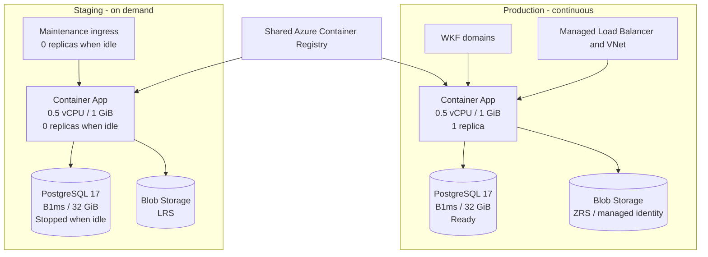

# Architecture

## Azure production and staging snapshot

**Last verified:** 2026-11-21, Europe/Warsaw

This section records the deployed WKF Online architecture and its observed cost profile. It is a
dated operational snapshot, not a fixed price list. Azure Cost Management can post recent usage
with a delay, and the current day was incomplete when the data was collected.

### Deployed topology

WKF Online uses two isolated Azure environments in Poland Central and one shared Azure Container
Registry:

- **Production** runs continuously in `rg-wkf-prod`. The application is an Azure Container App with
  0.5 vCPU, 1 GiB RAM, and exactly one replica. PostgreSQL Flexible Server 17 uses the
  `Standard_B1ms` Burstable SKU, 32 GiB storage, and 35-day backup retention. PostgreSQL and Blob
  Storage use private production networking; Storage is ZRS and accessed through managed identity.
- **Staging** is started only for deployments, migrations, checkpoints, and acceptance tests. The
  application and maintenance ingress both scale from zero, and had no running replicas during the
  verification. PostgreSQL Flexible Server 17 uses `Standard_B1ms`, 32 GiB storage, and seven-day
  backup retention. It was `Stopped` during verification and is started on demand, then stopped
  after the operation.
- **Shared infrastructure** in `rg-wkf-shared` contains the Azure Container Registry used by both
  environments.
- **Managed production infrastructure** is billed in the automatically created resource group
  `me_wkf-prod_rg-wkf-prod_polandcentral`. Its Load Balancer and Virtual Network are part of the
  production Container Apps Environment and are not optional line items in the current topology.
- Each environment also has a Log Analytics workspace, Blob Storage, a migration Container Apps
  Job, identities, alerts, and monthly cost guardrails. The current subscription budget is
  120 EUR per month.

### Observed operating pattern

Production infrastructure was created on 2026-10-24. For the monthly run-rate calculation, the
report uses the 28 complete usage days from 2026-10-24 through 2026-11-20 and excludes the partial
2026-11-21 usage day.

The staging activity log confirms the intended on-demand pattern. Recent completed sessions
started PostgreSQL for approximately 2.5 hours on 2026-11-18, 1.3 hours on 2026-11-19, and shorter
sessions on 2026-11-20 and 2026-11-21, followed by explicit stop operations. Stopped PostgreSQL
still incurs storage and backup-related charges, so staging does not fall to exactly zero.

### Current monthly estimate

The following amounts are derived from actual Azure Cost Management data rather than the public
price calculator. The billing currency is EUR.

| Component                                        | Estimated monthly cost |
| ------------------------------------------------ | ---------------------: |
| Production PostgreSQL B1ms                       |              16.91 EUR |
| Production Container App, one continuous replica |              11.65 EUR |
| Production managed Load Balancer                 |              16.31 EUR |
| Production managed Virtual Network               |               3.26 EUR |
| Shared Azure Container Registry                  |               4.68 EUR |
| Production DNS, Monitor, and Storage             |               0.79 EUR |
| **Production plus shared infrastructure**        |          **53.61 EUR** |
| Staging PostgreSQL, start/stop usage pattern     |               5.83 EUR |
| Staging Container Apps and Storage               |               1.00 EUR |
| **Incremental staging cost**                     |           **6.83 EUR** |
| **WKF Online production plus staging**           |    **60.44 EUR/month** |

At the European Central Bank reference rate for 2026-11-20, 1 EUR = 1.0990 USD. This corresponds
to approximately 58.92 USD per month for production plus shared infrastructure, 7.50 USD for the
observed staging pattern, and **66.42 USD per month for both environments**. Annualizing the current
pattern gives approximately **725.25 EUR / 797.05 USD per year**.

The complete Azure subscription also contains resources outside the current WKF Online topology,
mainly the `Default` resource group with Rollbot, an App Service plan, another Container Apps
Environment, and an older Container Registry. If those resources remain unchanged, the observed
whole-subscription run rate is approximately **104.21 EUR / 114.53 USD per month**. This distinction
matters when comparing WKF Online architecture costs with total nonprofit-grant consumption.

### 2026 grant consumption and forecast

The calculations below assume the 2,000 USD annual nonprofit grant used in the previous planning
memo. EUR-to-USD conversions use the ECB 2026-11-20 reference rate and are therefore approximate;
the Azure sponsorship balance remains authoritative.

| Measure                                                 |        EUR |  Approx. USD | Share of 2,000 USD grant |
| ------------------------------------------------------- | ---------: | -----------: | -----------------------: |
| Actual subscription cost, 2026-01-01 through 2026-11-21 |     274.11 |       301.25 |                   15.06% |
| Azure forecast for the remainder of 2026                |     127.93 |       140.59 |                    7.03% |
| **Forecast 2026 total**                                 | **402.04** |   **441.84** |               **22.09%** |
| **Forecast unused grant**                               |          - | **1,558.16** |               **77.91%** |

Year-to-date cost attribution is 114.09 EUR for WKF production, staging, shared infrastructure,
and short-lived recovery drills, plus 160.03 EUR for the `Default` resource group. The latter is
part of total grant consumption but not part of the current WKF Online production-and-staging
architecture.

### Evidence and calculation method

- Live resource state was read with Azure CLI on 2026-11-21.
- Actual cost used the Cost Management Query API `2023-11-01` with `ActualCost`.
- Production start was established from the first successful production deployment operations on
  2026-10-24.
- Monthly estimates annualize the 28 complete days from 2026-10-24 through 2026-11-20 using the
  average Gregorian month length of 30.4375 days.
- The year-end estimate uses the Cost Management Forecast API `2023-11-01`: 20.32 EUR forecast for
  the remainder of November and 107.61 EUR for December.
- The exchange rate source is the [ECB reference rate for 2026-11-20](https://www.ecb.europa.eu/stats/policy_and_exchange_rates/euro_reference_exchange_rates/html/index.en.html).

Re-run the cost snapshot after a material architecture change, after a full calendar month of
production, or when the staging usage pattern changes substantially.
